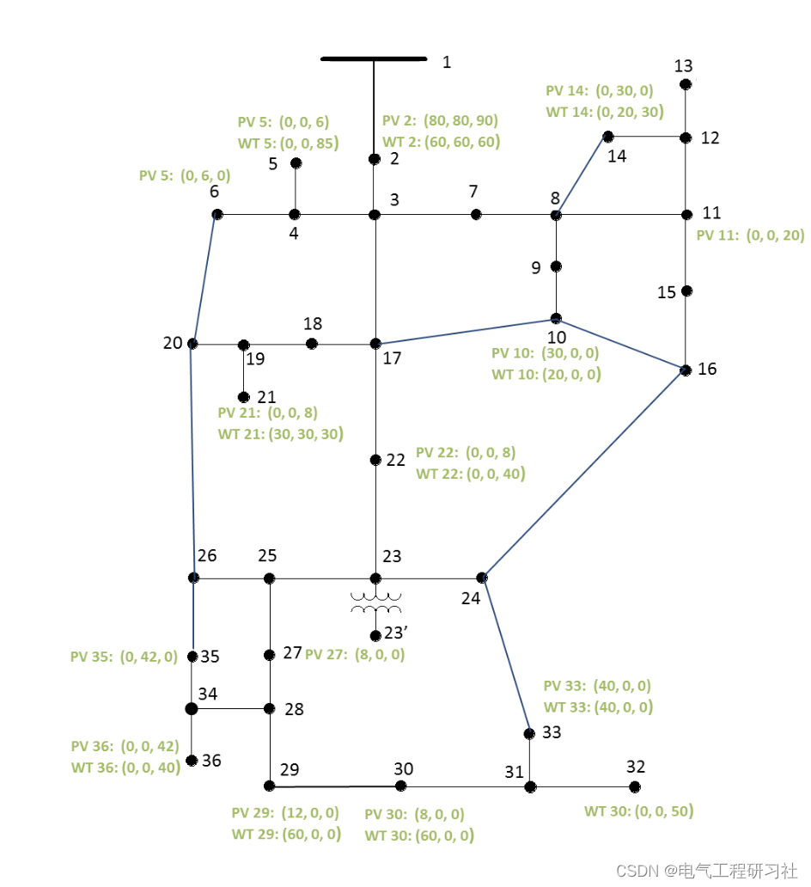
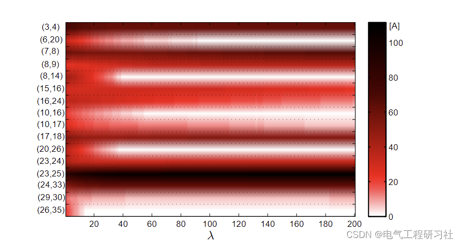
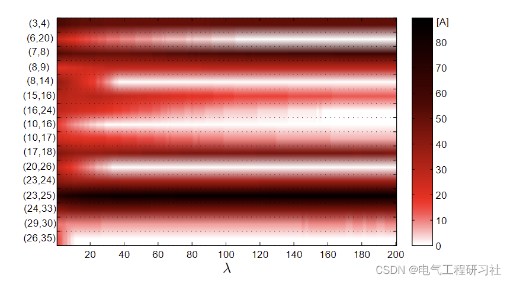
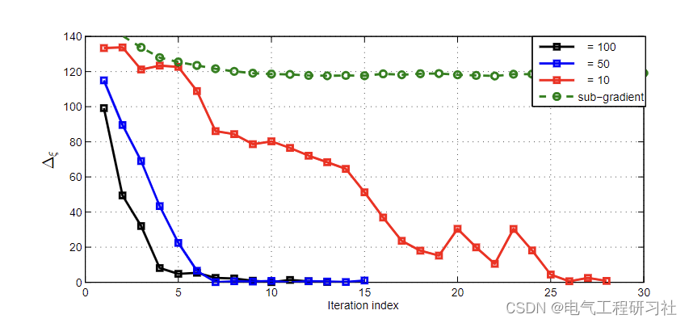
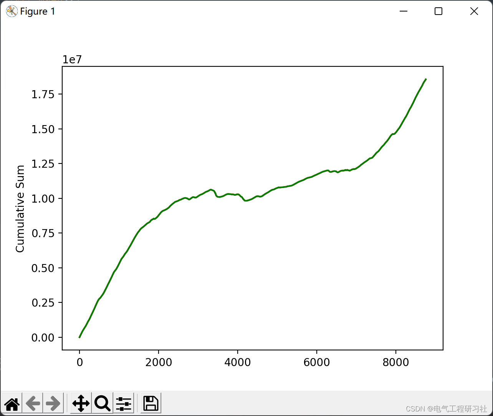
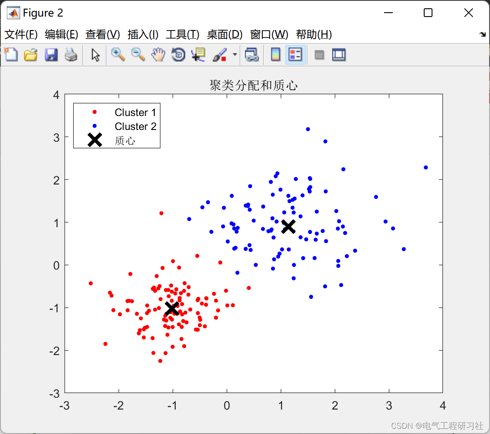
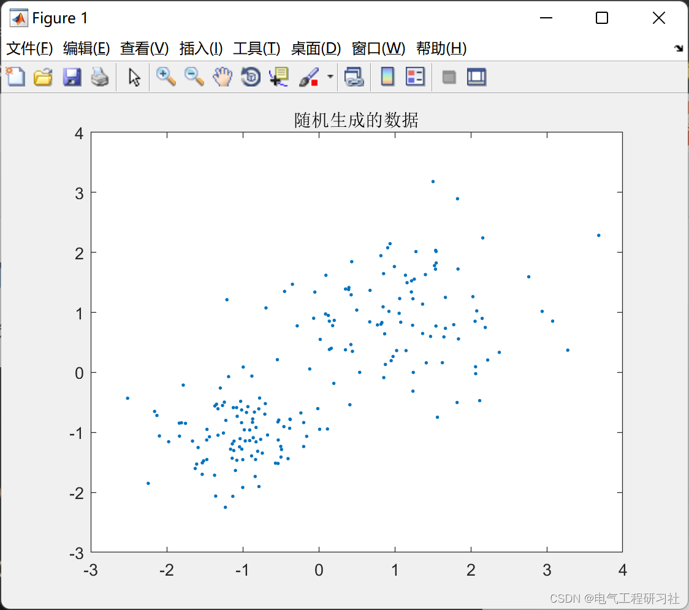
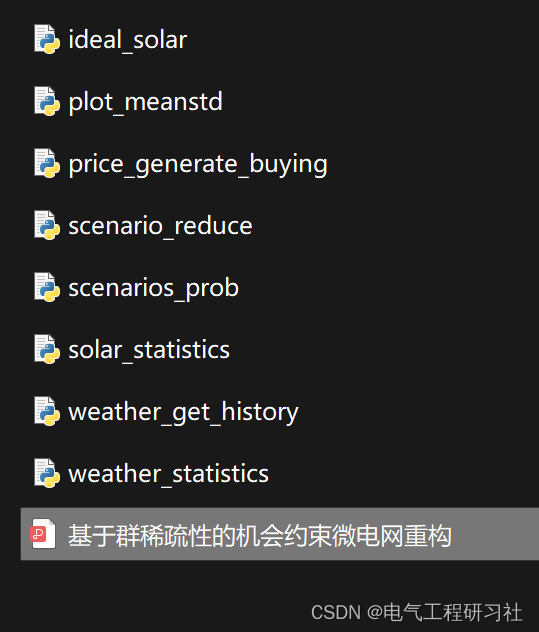

# Microgrid Reconfiguration | Opportunistic Constraint-Based Microgrid Reconfiguration (Matlab Code and Python Code)

​  
Existing renewable energy generation and load forecasting errors. Considered the task of system reconfiguration for existing power distribution systems and microgrids. The system topology is obtained by solving the opportunity constraint optimization problem. It enforces the load loss (LOL) constraints and current carrying capacity limits on power distribution lines. Similar to the reconfiguration format of various distribution systems, Due to the existence of binary line selection variables, Therefore, solving the problem is very difficult in computation. Furthermore, The lack of a closed-form expression for the joint probability distribution of prediction error hinders the manageability of LOL constraints. However, By adopting the technique of situational approximation. And exploit the potential group sparsity property of current flowing on a distribution circuit equipped with connection and segmentation switches, This paper re-states a convex problem.The new convex LOL constrained reconfiguration scheme also provides a distributed solution using the alternating direction method of multipliers to address the scenario where multiple facilities are independently managed from the rest of the system. In summary, the structure of this paper is as follows: [1] A novel problem of reconfiguring distribution systems with load and renewable energy generation prediction errors, which enforces LOL probability constraints and maximum current limits; [2] By adopting Monte Carlo-based scenario approximation techniques [20] and sparse proximal regularization techniques that were first used in [28], we can obtain computationally affordable convex relaxations; [3] An ADMM-based algorithm is proposed to solve the risk-aware system reconfiguration problem in a decentralized manner.2 Mathematical Model
Detailed mathematical models and explanations are provided in Part 4.
3 Case simulation and results editing
Figure 1: Improved IEEE 37-node test feeder
Editing
Editing
Editing
Editing
4 Matlab and Python code and article detailed explanations
This article only showcases a portion of the code, all code, articles, and data can be found in:
rng default; % For reproducibility\nX = [randn(100,2)*0.75+ones(100,2);\n    randn(100,2)*0.5-ones(100,2)];\n\nfigure;\nplot(X(:,1),X(:,2),'.');\ntitle 'Randomly generated data';\n\nopts = statset('Display','final');\n[idx,C] = kmeans(X,2,'Distance','cityblock',...\n    'Replicates',5,'Options',opts);\n\nfigure;\nplot(X(idx==1,1),X(idx==1,2),'r.','MarkerSize',12)\nhold on\nplot(X(idx==2,1),X(idx==2,2),'b.','MarkerSize',12)\nplot(C(:,1),C(:,2),'kx',...\n     'MarkerSize',15,'LineWidth',3)\nlegend('Cluster 1','Cluster 2','Center of mass',...\n       'Location','NW')\ntitle 'Clustering and centroid'\nhold off\n  
Editing  
5 Conclusions: In the presence of errors in power generation and load forecasting based on renewable energy, system reconfiguration for microgrids is considered. To address potential supply-demand imbalances, a novel opportunity-constrained optimization problem is proposed to limit the probability of LOL (Line Outage Probability) while strictly adhering to line flow capacity constraints. The innovative reconfiguration method leverages regularization terms that promote sparsity to influence line selection, and employs scenario optimization techniques to approximate the probability constraints. The results of the proposed formula lead to a convex program, requiring a balanced constraint at each stage and node. Finally, a novel decentralized reconfiguration scheme is developed, which reframes a convex problem in this paper. The new convex LOL constraint reconstruction scheme can also provide distributed solutions using the multiplicative alternating direction method of multipliers to address scenarios where multiple facilities are independently managed from the rest of the system.  
6 References

## Images

<!-- PAYMENT_BLOCK -->

## Get this dataset

- Payment link (Stripe): [Buy now](https://buy.stripe.com/3cs8yP7sY87d0vu9AB)
- Payment QR code: 

<!-- /PAYMENT_BLOCK -->
